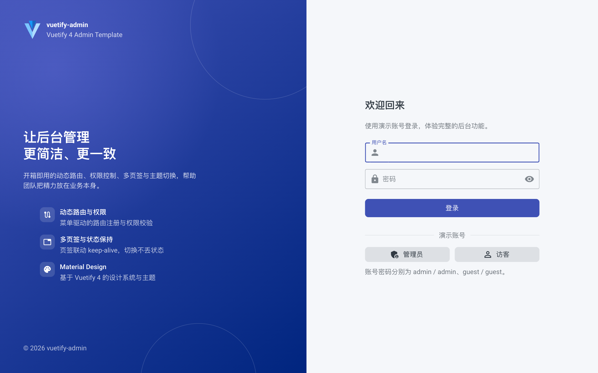
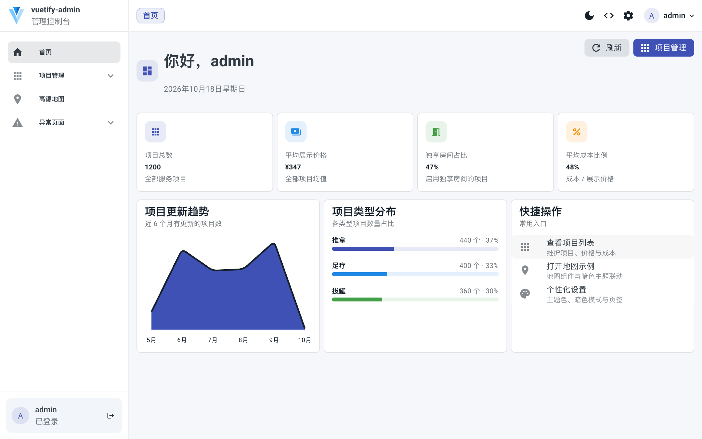
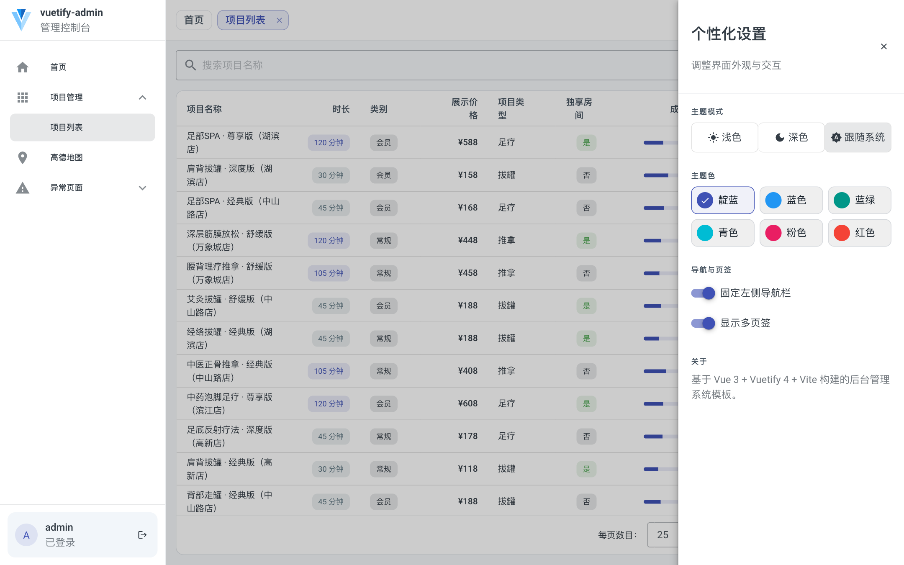

# vuetify-admin

基于 Vue 3 + Vuetify 4 + Vite + TypeScript 的后台管理系统模板，内置动态路由、权限校验、多页签 keep-alive、主题切换与首页仪表盘；数据由本地 Mock 提供。

## 在线体验

[Live Demo](https://vuetify.3mo.me)

演示账号：`admin / admin`（完整权限）、`guest / guest`（只读）。

## 界面预览

### 登录页



### 首页仪表盘



### 项目列表与个性化设置



## 功能

- 动态路由与登录守卫，菜单由后端接口驱动，支持路由级权限校验
- 基于权限码的操作级权限控制（`AuthProvider` / `usePermissions`）
- 多页签 + keep-alive，页签状态可持久化，首页固定不可关闭
- Material Design 色彩角色，支持亮色 / 深色 / 跟随系统与 6 种主题色
- 首页仪表盘：统计卡片、项目更新趋势、类型分布与快捷入口
- 项目列表：服务端分页 / 排序 / 搜索，新增、编辑、查看与删除
- 高德地图示例页面
- 自研增强组件：`DataTable`、`FormDrawer`、`Toast`、`ImgUpload`、`PageHeader` 等
- 本地 Mock API（`axios-mock-adapter`），按环境启用

## 技术栈

Vue 3.5 · Vuetify 4 · Pinia 4 · Vue Router 5 · TypeScript 5.9 · Vite 8（Rolldown）· Tailwind CSS 4（`tw:` 前缀）· ESLint 10

## 环境要求

- Node.js `>= 22.13.0`
- pnpm

## 开发

```bash
pnpm i
pnpm dev
```

## 脚本

```bash
pnpm dev        # 启动开发服务器
pnpm build      # 类型检查 + 生产构建
pnpm typecheck  # vue-tsc --noEmit
pnpm lint       # ESLint
pnpm preview    # 预览构建产物
```

## 目录结构

```text
src/
├── api/           # 业务接口与类型定义
├── components/    # 自研 Vuetify 增强组件
├── composables/   # usePromiseFn / usePermissions 等
├── config/        # 路由常量与主题配置
├── layout/        # 顶栏、侧栏、内容区与个性化设置
├── mock/          # 本地 Mock 数据与处理函数
├── router/        # 动态路由注册、权限守卫
├── store/modules/ # 账号、设置、页签状态
└── views/         # 登录、首页、项目列表、地图、异常页
```

## Mock

开发环境默认启用本地 Mock（`.env.development` 中 `VITE_USE_MOCK=true`），生产构建默认关闭。若需在生产预览 Mock，可在构建时设置 `VITE_USE_MOCK=true`。

Mock 数据在内存中修改，刷新页面后恢复为初始值。
